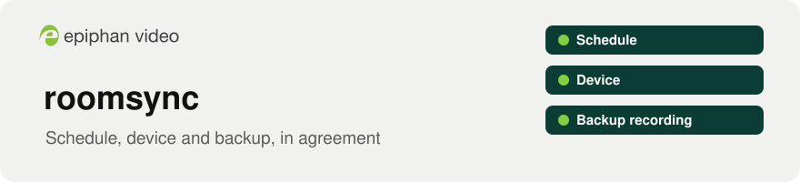
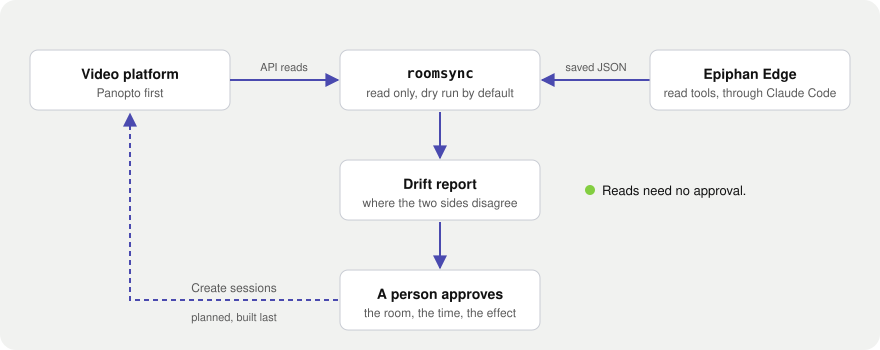

<p align="center">
  <picture>
    <source media="(prefers-color-scheme: dark)" srcset="docs/assets/banner-dark.svg">
    
  </picture>
</p>

<p align="center">
  <a href="https://github.com/ScientiaCapital/roomsync/actions/workflows/ci.yml"></a>
  
  <a href="LICENSE"></a>
  
</p>

<p align="center">
  <a href="#what-it-will-do">What it will do</a> ·
  <a href="#how-it-fits-together">How it fits together</a> ·
  <a href="#whats-verified-about-panopto">What's verified</a> ·
  <a href="#quick-start">Quick start</a> ·
  <a href="SECURITY.md">Security</a>
</p>

# roomsync

Keep a school's video-platform schedule, the state of each room's Epiphan device, and the device's backup recording in agreement. roomsync will read the platform (Panopto first) and each Epiphan device through Epiphan Edge and the Model Context Protocol (MCP), tell you where they disagree, and create nothing until a person approves a dry run.

Scheduling a full semester of classes means a lot of rows to get right, and nothing tells you a room's device is offline until a class doesn't record. roomsync is meant to close that gap. For each room, it will answer one question: will the next class record?

## What it will do

| Layer | What happens | State |
|---|---|---|
| Read | List the platform's remote recorders. Read Epiphan Edge events from a saved file | `recorders` and `edge-events` built, not yet run against a real Panopto site |
| Compare | Report where the two sides disagree, such as a session missing from one side, a time mismatch, or a room recording with no scheduled session | Built as a library, no command yet |
| Check | Answer "will tomorrow's classes record?" for each room: the device is online, the source has a signal, and there's space for the class length | Planned |
| Plan | Turn a semester class schedule file into the sessions it would create on the platform, as a dry run | Planned |
| Apply | Create the sessions after a person approves the plan, then confirm each device picked them up | Planned, built last |

A sketch of the planned drift report. Nothing prints this yet, and the rooms and times are placeholders:

```text
Room 204   Mon 9 a.m.    Ready          recorder online, signal on both sources, space for the class
Room 118   Tue 1 p.m.    Not ready      device offline
Room 310   Wed 3 p.m.    Not on device  scheduled on the platform, recorder not found in the fleet
Room 152   Thu 10 a.m.   UNVERIFIED     the documentation doesn't settle this check
```

## How it fits together

<p align="center">
  <picture>
    <source media="(prefers-color-scheme: dark)" srcset="docs/assets/architecture-dark.svg">
    
  </picture>
</p>

The video platform owns the schedule. Epiphan Pearl and EC20 devices register with Panopto as remote recorders and take their sessions from it. Each Pearl channel shows up in Panopto as a separate video source, so a room with a camera channel and a laptop channel records both. Epiphan documents this in [Panopto recording and webcasting setup](https://kb.epiphan.com/cms/panopto-recording-and-webcasting-setup) and [EC20 Panopto integration](https://kb.epiphan.com/ec20/ec20-panopto-integration).

Epiphan Edge, through the Epiphan MCP server, reads third-party platform events and each device's state. It can't change a Panopto session. Those are managed in Panopto. Python can't call MCP tools, so Edge data reaches roomsync as saved JSON. A Claude Code session reads the Edge tools, writes the JSON outside the repository, runs `roomsync edge-events` on it, and deletes the file.

A device sees only part of the platform's schedule. Epiphan documents up to 90 days of upcoming events depending on the platform, and one week for Panopto, so roomsync compares the two sides only inside a window the caller sets. Edge event IDs never match Panopto IDs, so roomsync pairs sessions by room and time.

Epiphan also documents that a scheduled event wins over an ad hoc recording: the device stops the ad hoc event when the scheduled one starts. roomsync flags a room that's recording with no scheduled session covering it, and warns when a scheduled start will cut that recording off. Both checks are reported as `UNVERIFIED` for now.

roomsync won't schedule on the device. A device follows one video platform at a time. Epiphan documents that scheduled platform events start and end automatically, that recorded files upload to the event owner's folder, and that a backup recording is saved locally, so roomsync leaves the schedule with the platform. To create sessions, it will call the platform's own API after a person approves a dry run.

## What's verified about Panopto

roomsync works from Panopto's published API description and OpenID discovery document, read from its hosted demo site. A customer's site may differ. In short:

- The API description is a Swagger 2.0 file that the docs page names in its inline script. Authentication comes from the OpenID discovery document, which lists the `api` scope and several grant types.
- The RemoteRecorderAPI group is for Panopto's hardware partners only and needs a partner API key. roomsync never calls it.
- Recorders can be searched with `GET /api/v1/remoteRecorders/search`. Scheduled recordings can be created, read, rescheduled (start and end time only), and cancelled one at a time, and a bulk CSV flow validates a file before it schedules anything. Uploading that file creates a job on Panopto, so it counts as a write. The dry run itself stays local.

A check the documentation doesn't settle is reported as `UNVERIFIED`.

## Quick start

There's nothing to install for users yet. To work on the project:

```bash
git clone https://github.com/ScientiaCapital/roomsync.git && cd roomsync
uv sync --group dev
uv run pytest -q                   # unit tests, no network
bash tests/hook-test.sh            # Edge write guard, redaction and secrets hook
uv run ruff check . && uv run ruff format --check .
```

Two commands exist, and both are read only:

```bash
uv run roomsync recorders --query "Room 204"     # Panopto remote recorders; needs .env
uv run roomsync edge-events --from events.json   # a saved Epiphan Edge event file
```

`recorders` hasn't run against a real Panopto site yet, so it prints an `UNVERIFIED` line about the grant type and scope. The comparison (`roomsync.reconcile`) is a library with no command yet. Planned commands: `roomsync doctor`, `roomsync check`, and `roomsync plan`, which is a dry run.

| Path | What it is |
|---|---|
| `src/roomsync/` | The package: the settings, the Panopto client, the Edge reader, the comparison, and the command line |
| `docs/assets/`, `scripts/build_readme_art.py` | The README banner and diagram, built from Epiphan Brand colors and the official logos |
| `.claude/settings.json`, `.claude/hooks/` | Edge write guard, redaction and secrets hooks for Claude Code |
| `tests/` | Unit tests and the hook and permission tests, with redaction cases shared with Fleetwatch |
| `.env.example` | The settings roomsync will read. Copy it to `.env`, which is gitignored |
| `AGENTS.md`, `CONTRIBUTING.md` | The rules for AI assistants and for people. They're the same rules |

## Working with Claude Code and Epiphan Edge

The project folder includes the same safety hooks as the [Epiphan Edge Claude Kit](https://github.com/ScientiaCapital/epiphan-edge-claude-kit). Reads run without asking. Every write asks first. Stream keys and passwords are replaced with a placeholder before Claude sees them, and bypass mode is off. `EPIPHAN_READ_ONLY=1 claude` blocks every Edge write outright. Check which Edge team you're signed in to before any write, because it might be a shared demo fleet.

Epiphan Edge's sign-in has no read-only scope, so the token can do whatever its account can. Use a least-access account. The trust model and known limits are in [SECURITY.md](SECURITY.md).

## Data handling

roomsync reads schedules that name rooms, courses, and instructors. None of that belongs in this repository. Schedules, reports, and session logs stay on your machine and are gitignored. Credentials belong in a `.env` file, which is gitignored. The `Settings` class holds secrets as `SecretStr` and accepts only an https platform URL. Tests use placeholders and run without a network.

## Development

Python 3.12, uv, ruff, and pytest. Work on a branch and open a pull request with the commands you ran and their output. Commit messages follow Conventional Commits. CI runs lint, tests on Linux and macOS, the hook and permission tests, and a gitleaks scan of the full history. Main needs a second reviewer.

To rebuild the README art after a change, run `python3 scripts/build_readme_art.py`.

[AGENTS.md](AGENTS.md) has the rules for AI assistants, and the same rules apply to people. [CONTRIBUTING.md](CONTRIBUTING.md) says what helps most.

## Status

Early. Built: the settings, a read-only Panopto recorder search, the Edge event reader, and the comparison with its ad hoc checks, all tested without a network. Waiting on: Panopto demo credentials to try the recorder search on a real site. Next steps: a `roomsync check` command that joins both sides, then the semester dry run.

## License

Copyright 2026 Epiphan Systems Inc. Licensed under the [Apache License 2.0](LICENSE); see [NOTICE](NOTICE) for third-party components.

roomsync is not an officially supported Epiphan product. Epiphan, Epiphan Edge, Pearl, and EC20 are trademarks of Epiphan Systems Inc. Panopto is a trademark of its owner.
